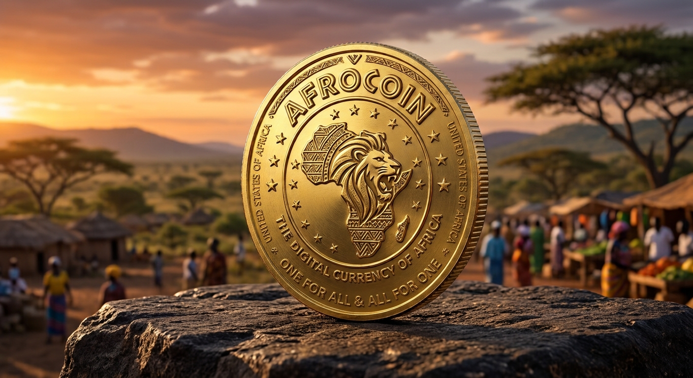

# 🦁 Afrocoin (AFR)
### **The Digital Cash & Sovereign Currency of the United States of Africa**

---

## 🚀 Executive Summary for Investors
**Afrocoin (AFR)** is strategically engineered to bridge continental monetary sovereignty with institutional-grade global finance. With a strictly limited total supply of **106,188,667 AFR**, the protocol unifies Africa's 54 emerging economies under a single, high-velocity digital cash framework supported by world-class banking standards.

* **Token Name:** Afrocoin
* **Token Symbol:** AFR
* **Blockchain Standard:** ERC-20 (Ethereum Network)
* **Total Supply:** 106,188,667 USD 
* **Official Website:** [afrocoin.org](https://afrocoin.org)
* **Deployer / Treasury Wallet:** `0x09ae2d267AF485a387f5495b6e2F7c427CD5d1a3`

---

## 🌍 Afrocoin (AFR): The Sovereign Digital Cash of the United States of Africa

### 💡 Core Vision: Bridging Monetary Sovereignty and Global Liquidity
**Afrocoin (AFR)** is not just a speculative crypto asset, but a revolutionary *digital cash* instrument built to unite cross-border economies across Africa under a single guiding vision: the **United States of Africa**. With a fixed total supply of **106,188,667 USD**, the token merges the philosophy of local monetary sovereignty with the speed, security, and reliability of global institutional-grade payment networks.

---

## 📈 Institutional Architecture & Financial Bridge
To scale trust and compliance, Afrocoin integrates traditional institutional powerhouses with cutting-edge blockchain rails:

1. **Deutsche Bank Integration:** Secures institutional-grade custody solutions, international trade settlements, and cross-continental liquidity management.
2. **ABSA Bank Synergy:** Powers robust regional compliance, seamless fiat-to-crypto gateways, and widespread commercial adoption across African markets.
3. **Visa Network Ready:** Empowers millions of users to spend AFR instantly via global payment rails, merging decentralized sovereignty with everyday utility.

---

## 🛡️ Philosophy & Security
* **Motto:** *"One for All & All for One"* — Representing the economic solidarity of 54 nations within a single, inclusive digital ecosystem.
* **ERC-20 Standard:** Guarantees full transparency on a secure, easily verifiable blockchain integrated seamlessly with global digital wallets and decentralized finance (DeFi).

---

## 💎 Why Invest in Afrocoin?
* **Massive Market Opportunity:** Tapping into Africa's fast-growing digital economy and unbanked population under the unifying vision of the *United States of Africa*.
* **Institutional Security:** Backed by verifiable ERC-20 smart contracts and harmonized with tier-1 global banking infrastructure.
* **Uncompromising Vision:** Operating under the timeless motto: *"One for All & All for One"*, ensuring economic inclusivity and mutual growth for all stakeholders.
