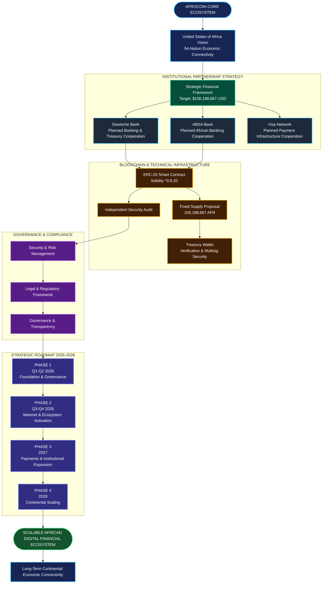

# 🗺️ AFROCOIN (AFR)
# MASTER STRATEGIC ROADMAP 2026–2028

**Project:** Afrocoin (AFR)  
**Vision:** United States of Africa  
**Mission:** Building a Unified African Digital Financial Ecosystem  
**Blockchain Standard:** Ethereum ERC-20  
**Smart Contract Language:** Solidity ^0.8.20  
**Total Token Supply:** 106,188,667 AFR  
**Financial Framework Target:** $106,188,667 USD  
**Geographic Scope:** 54 African Nations  
**Roadmap Period:** 2026–2028  
**Document Status:** Strategic Development Plan  
**Partnership Status:** Planned / Subject to Formal Agreements

---

# 1. EXECUTIVE SUMMARY

Afrocoin (AFR) is a proposed blockchain-based digital financial ecosystem designed to support financial connectivity, digital payments, economic cooperation, and financial inclusion across Africa.

The long-term objective is to establish a scalable digital financial infrastructure capable of connecting individuals, businesses, merchants, financial institutions, and economic participants across the African continent.

Afrocoin aims to develop an ecosystem built around:

- Blockchain technology.
- Digital asset infrastructure.
- Financial inclusion.
- Cross-border payment capabilities.
- Merchant payment integration.
- Institutional financial partnerships.
- Transparent treasury management.
- Decentralized governance.
- Continental economic cooperation.

The project envisions a future in which digital financial infrastructure can support economic participation across all 54 African nations.

Afrocoin is intended to develop progressively through three major stages:

1. Foundation and Infrastructure Development — 2026.
2. Ecosystem Expansion and Financial Integration — 2027.
3. Continental Adoption and Economic Scaling — 2028.

All institutional relationships, regulatory approvals, financial backing, and payment integrations remain subject to independent verification, negotiations, and formal authorization.

---

# 2. VISION AND MISSION

## 2.1 Vision

To contribute to a more financially connected, technologically advanced, and economically integrated Africa through accessible digital financial infrastructure.

## 2.2 Mission

Afrocoin aims to:

- Expand access to blockchain-based financial services.
- Support digital payment innovation.
- Facilitate cross-border financial connectivity.
- Encourage African digital entrepreneurship.
- Develop transparent financial infrastructure.
- Support merchant and business participation.
- Promote financial technology collaboration.
- Build interoperable digital economic infrastructure.

## 2.3 Strategic Objectives

The primary objectives are:

1. Establish a secure and transparent blockchain infrastructure.
2. Develop a sustainable digital asset ecosystem.
3. Build a credible institutional partnership framework.
4. Develop compliant payment infrastructure.
5. Expand merchant and business adoption.
6. Support economic participation across African markets.
7. Establish transparent treasury and governance systems.
8. Develop long-term continental scalability.

---

# 3. PROJECT OVERVIEW

## 3.1 Project Identity

| Category | Specification |
|---|---|
| Project Name | Afrocoin |
| Token Symbol | AFR |
| Blockchain | Ethereum |
| Token Standard | ERC-20 |
| Smart Contract | Solidity ^0.8.20 |
| Total Supply | 106,188,667 AFR |
| Primary Objective | Digital Financial Ecosystem |
| Geographic Focus | Africa |
| Strategic Coverage | 54 African Nations |
| Roadmap | 2026–2028 |

## 3.2 Core Ecosystem Components

Afrocoin's proposed ecosystem consists of:

- AFR Digital Token.
- Smart Contract Infrastructure.
- Treasury Management.
- Governance Framework.
- Digital Payment Infrastructure.
- Merchant Ecosystem.
- Exchange and Liquidity Infrastructure.
- Institutional Partnership Network.
- Compliance and Risk Management.
- Developer and Community Ecosystem.

## 3.3 Ecosystem Development Philosophy

Afrocoin will prioritize:

- Security before expansion.
- Transparency before institutional scaling.
- Regulatory compliance before financial integration.
- Real utility before speculative adoption.
- Sustainable development before rapid growth.

---

# 4. FINANCIAL BACKING FRAMEWORK

## 4.1 Strategic Financial Framework

**Proposed Financial Framework Target: $106,188,667 USD**

The project identifies a financial framework target intended to support ecosystem development, operational infrastructure, liquidity planning, technology development, and long-term expansion.

This figure is a strategic planning target and must not be interpreted as verified cash reserves, deposited capital, or committed institutional funding unless supported by independently verifiable documentation.

## 4.2 Proposed Financial Allocation Framework

The following allocation is an initial planning proposal, not an existing allocation or verified balance.

| Category | Proposed Allocation | Amount |
|---|---:|---:|
| Treasury & Financial Reserves | 30% | $31,856,600.10 |
| Technology & Blockchain | 20% | $21,237,733.40 |
| Payment Infrastructure | 15% | $15,928,300.05 |
| Liquidity & Market Infrastructure | 15% | $15,928,300.05 |
| Institutional & Compliance | 10% | $10,618,866.70 |
| Ecosystem & Community | 5% | $5,309,433.35 |
| Operations & Contingency | 5% | $5,309,433.35 |
| **TOTAL** | **100%** | **$106,188,667.00** |

## 4.3 Treasury Management

The treasury framework should include:

- Independent financial oversight.
- Documented asset custody arrangements.
- Multi-signature authorization.
- Periodic financial reporting.
- Independent financial audits.
- Risk management procedures.
- Clearly documented reserve policies.
- Separation of operational and treasury assets.

## 4.4 Financial Transparency

Afrocoin intends to implement:

1. Treasury reporting.
2. Public financial disclosures.
3. Independent verification where applicable.
4. Transparent allocation records.
5. Operational expenditure reporting.
6. Reserve and liquidity disclosures.

Proof of reserves must only be published when supported by reliable evidence and an appropriate verification methodology.

---

# 5. INSTITUTIONAL AND BANKING ARCHITECTURE

## 5.1 Institutional Partnership Strategy

Afrocoin intends to explore institutional cooperation with established financial and payment organizations.

These are planned strategic partnership targets, not confirmed relationships.

## 5.2 Planned Strategic Banking Partners

### Deutsche Bank

**Proposed Role:** International Banking and Treasury Infrastructure.

Potential areas of cooperation:

- Institutional banking services.
- Treasury management.
- Custody solutions, subject to eligibility.
- Financial risk management.
- International financial operations.

Status: Planned / Subject to Formal Agreement.

### ABSA Bank

**Proposed Role:** African Regional Banking Infrastructure.

Potential areas of cooperation:

- Regional banking connectivity.
- African financial market access.
- Corporate banking services.
- Payment infrastructure exploration.
- Regulatory and compliance coordination.

Status: Planned / Subject to Formal Agreement.

### Visa Network

**Proposed Role:** Global Payment Network Integration.

Potential areas of cooperation:

- Card-based payment infrastructure.
- Merchant payment acceptance.
- Payment processing partnerships.
- Consumer spending infrastructure.
- Digital payment interoperability.

Visa network integration would require an approved issuing, acquiring, processing, or program partner, as applicable.

Status: Planned / Subject to Formal Agreement and Approval.

## 5.3 Institutional Partnership Requirements

Before announcing any partnership, Afrocoin should obtain:

- Formal letters of intent where applicable.
- Signed agreements.
- Counterparty verification.
- Legal authorization.
- Compliance approval.
- Technical integration documentation.
- Permission to use institutional names and trademarks.

No institution should be represented as an official partner without appropriate authorization.

---

# 6. TOKENOMICS AND DIGITAL ASSET STRUCTURE

## 6.1 Token Specifications

| Parameter | Specification |
|---|---|
| Token Name | Afrocoin |
| Token Symbol | AFR |
| Blockchain | Ethereum |
| Token Standard | ERC-20 |
| Solidity Version | ^0.8.20 |
| Total Supply | 106,188,667 AFR |
| Decimal Precision | 18 (proposed) |
| Supply Model | Fixed Supply (proposed) |
| Minting | Disabled after deployment, if fixed supply is adopted |
| Burning | Only if explicitly specified and audited |
| Upgradeability | To be determined before deployment |

## 6.2 Token Distribution Framework

The following is a proposed allocation for tokenomics planning.

| Allocation Category | Percentage |
|---|---:|
| Ecosystem Development | 25% |
| Treasury & Strategic Reserves | 20% |
| Public Distribution | 15% |
| Liquidity Provision | 15% |
| Community & Adoption | 10% |
| Team & Contributors | 10% |
| Partnerships & Development Grants | 5% |
| **TOTAL** | **100%** |

Final allocations must be approved and documented before token generation or public distribution.

## 6.3 Vesting Framework

Proposed vesting principles:

- Team allocation: 12-month cliff followed by 36-month linear vesting.
- Ecosystem allocation: Released according to approved development milestones.
- Strategic reserves: Subject to treasury governance.
- Community allocation: Released through transparent distribution programs.
- Partnership allocation: Released only under documented agreements.

The final vesting schedule must be implemented transparently through audited contracts or verifiable treasury procedures.

## 6.4 Token Utility

Potential AFR utility includes:

1. Digital ecosystem participation.
2. Merchant payment functionality.
3. Platform service payments.
4. Ecosystem incentives.
5. Governance participation, if legally and technically appropriate.
6. Cross-border digital payment use cases.
7. Developer ecosystem participation.

Token utility must be implemented through actual services and must not imply guaranteed appreciation, profit, or redemption.

---

# 7. SMART CONTRACT AND BLOCKCHAIN INFRASTRUCTURE

## 7.1 Technical Foundation

Afrocoin will use Ethereum-compatible blockchain infrastructure.

Proposed technical components:

- ERC-20 token contract.
- Solidity ^0.8.20.
- OpenZeppelin-based secure implementations.
- Hardhat or Foundry development environment.
- Automated testing.
- Static code analysis.
- Contract verification.
- Multisignature treasury architecture.

## 7.2 Smart Contract Requirements

The smart contract development process should include:

- ERC-20 compliance.
- Supply verification.
- Access-control review.
- Ownership and administrative controls.
- Event logging.
- Reentrancy assessment where relevant.
- Integer and authorization checks.
- Emergency procedures where justified.
- Deployment reproducibility.

## 7.3 Treasury Wallet

Proposed Treasury Wallet:

`0x09ae2d267AF485a387f5495b6e2F7c427CD5d1a3`

This address must be independently verified before being presented as an official project treasury.

Recommended requirements:

- Address ownership verification.
- Multisignature protection.
- Hardware wallet security.
- Transaction approval policies.
- Public verification where appropriate.
- Monitoring and incident response.

## 7.4 Blockchain Infrastructure

The project should establish:

- Mainnet deployment.
- Testnet deployment.
- Block explorer verification.
- Contract source publication.
- Public token metadata.
- Transaction monitoring.
- Developer documentation.
- Infrastructure monitoring.

## 7.5 Smart Contract Security Audit

Before mainnet deployment:

1. Internal code review.
2. Automated vulnerability scanning.
3. Independent security audit.
4. Remediation of critical and high-risk findings.
5. Regression testing.
6. Deployment verification.
7. Post-deployment monitoring.

No contract should be described as audited until an actual audit report is available.

---

# 8. GOVERNANCE AND INSTITUTIONAL CONTROL

## 8.1 Governance Framework

Afrocoin intends to develop a transparent governance structure that balances operational accountability with community participation.

Proposed governance layers:

- Foundation or operating entity.
- Executive management.
- Technical development team.
- Financial oversight.
- Compliance and legal oversight.
- Community governance.
- Independent security oversight.

The final legal entity and governance model must be determined through professional legal advice.

## 8.2 Community Governance

Potential governance capabilities:

- Community proposals.
- Voting mechanisms.
- Ecosystem development proposals.
- Treasury expenditure proposals.
- Community grants.
- Governance reporting.

Governance rights must be clearly defined and must not conflict with applicable securities, financial services, or corporate laws.

## 8.3 Transparency Principles

All major governance decisions should be:

- Documented.
- Traceable.
- Publicly communicated where appropriate.
- Subject to accountability.
- Consistent with applicable laws.

---

# 9. SECURITY AND RISK MANAGEMENT

## 9.1 Security Architecture

Afrocoin will prioritize security across its technical and operational infrastructure.

Security measures:

- Multisignature treasury wallets.
- Secure private-key management.
- Hardware security.
- Smart contract audits.
- Continuous monitoring.
- Access-control policies.
- Incident response procedures.
- Backup and recovery systems.

## 9.2 Risk Categories

| Risk | Mitigation Strategy |
|---|---|
| Smart Contract Risk | Independent audits and testing |
| Treasury Risk | Multisignature and financial controls |
| Cybersecurity Risk | Monitoring and incident response |
| Regulatory Risk | Jurisdiction-specific legal review |
| Liquidity Risk | Responsible liquidity planning |
| Operational Risk | Internal controls and documentation |
| Partnership Risk | Counterparty due diligence |
| Market Risk | Transparent risk disclosures |
| Reputation Risk | Accurate public communications |

## 9.3 Bug Bounty Program

Following a secure deployment, Afrocoin may establish a vulnerability disclosure and bug bounty program.

The program should include:

- Responsible disclosure policy.
- Vulnerability severity classification.
- Defined reporting procedures.
- Authorized testing boundaries.
- Reward framework.
- Remediation timelines.

---

# 10. PAYMENT INFRASTRUCTURE AND MERCHANT ECOSYSTEM

## 10.1 Digital Payment Vision

Afrocoin intends to explore practical digital payment applications that support commerce and financial connectivity.

Potential use cases:

- Merchant payments.
- Digital commerce.
- Business-to-business payments.
- Cross-border settlement exploration.
- Digital wallet integration.
- Payment application development.

## 10.2 Merchant Ecosystem

Potential merchant categories:

- Retail businesses.
- E-commerce platforms.
- Hospitality businesses.
- Service providers.
- Technology companies.
- Small and medium enterprises.

## 10.3 Payment Development Requirements

The payment infrastructure must consider:

- Transaction processing.
- Wallet security.
- Merchant onboarding.
- Customer verification where required.
- Fraud prevention.
- Refund and dispute handling.
- Consumer protection.
- Applicable financial regulations.

## 10.4 Visa Integration Strategy

The project may explore Visa-related infrastructure through authorized payment partners.

Potential stages:

1. Payment infrastructure research.
2. Identification of eligible issuing and acquiring partners.
3. Compliance and risk assessment.
4. Commercial negotiations.
5. Technical integration planning.
6. Pilot program.
7. Approved commercial deployment.

No direct Visa integration should be claimed before formal authorization.

---

# 11. EXCHANGE AND LIQUIDITY INFRASTRUCTURE

## 11.1 Exchange Strategy

Afrocoin intends to evaluate responsible digital asset market infrastructure.

Potential development areas:

- Decentralized exchange availability.
- Centralized exchange applications.
- Liquidity provider relationships.
- Market infrastructure.
- Token information transparency.

## 11.2 Liquidity Management

Liquidity planning should include:

- Transparent liquidity allocation.
- Treasury oversight.
- Risk controls.
- Independent monitoring.
- Clear disclosures.
- Protection against misleading market activity.

## 11.3 Exchange Listing Requirements

Before pursuing exchange listings:

- Smart contract verification.
- Legal review.
- Token documentation.
- Security audit.
- Project due diligence.
- Tokenomics disclosure.
- Risk documentation.

Exchange listing is subject to each platform's independent approval.

---

# 12. REGULATORY AND LEGAL FRAMEWORK

## 12.1 Regulatory Strategy

Afrocoin recognizes that financial and digital asset regulations differ between countries.

The project must conduct jurisdiction-specific assessments before launching financial services or offering tokens to the public.

## 12.2 Compliance Priorities

- Anti-Money Laundering (AML).
- Know Your Customer (KYC), where applicable.
- Counter-Terrorist Financing (CTF).
- Data protection.
- Consumer protection.
- Financial promotions.
- Digital asset classification.
- Cross-border payment regulations.
- Tax obligations.
- Licensing and authorization.

## 12.3 African Market Expansion

The project should conduct a country-by-country regulatory assessment before operating in each market.

The 54-nation expansion strategy must recognize differences in financial laws, payment systems, currencies, and regulatory institutions.

---

# 13. CONTINENTAL EXPANSION STRATEGY

## 13.1 African Economic Connectivity

Afrocoin's long-term ambition is to support stronger digital financial connectivity across Africa.

The strategy will explore cooperation with:

- Businesses.
- Financial technology companies.
- Payment service providers.
- Financial institutions.
- Developers.
- Universities.
- Merchant associations.
- Regional economic organizations.

## 13.2 Regional Expansion Model

The expansion framework may be organized into five regional groups:

1. North Africa.
2. West Africa.
3. Central Africa.
4. East Africa.
5. Southern Africa.

Each regional deployment will require independent commercial, technical, legal, and regulatory validation.

## 13.3 Economic Development Priorities

Potential long-term areas:

- Digital commerce.
- SME participation.
- Financial technology education.
- Merchant payment infrastructure.
- Digital entrepreneurship.
- Financial inclusion.
- Regional payment interoperability.

Afrocoin does not claim to replace national currencies, central banks, or sovereign monetary institutions.

---

# 14. MASTER IMPLEMENTATION ROADMAP

## PHASE 1 — FOUNDATION AND GOVERNANCE
### Q1–Q2 2026

**Strategic Objective:** Establish the project's technical, organizational, and governance foundations.

Key deliverables:

- Project identity and documentation.
- Strategic vision and mission.
- Initial tokenomics design.
- Smart contract architecture.
- Repository organization.
- Development environment.
- Governance framework.
- Treasury security planning.
- Legal and regulatory research.
- Partnership strategy documentation.

Success criteria:

- Documentation published.
- Technical specifications approved.
- Repository organized.
- Governance proposal documented.
- Security requirements established.

Status: Historical target period; completion must be independently reviewed.

## PHASE 2 — MAINNET AND ECOSYSTEM ACTIVATION
### Q3–Q4 2026

**Strategic Objective:** Prepare and execute the initial blockchain deployment and ecosystem activation.

Key deliverables:

- ERC-20 contract development.
- Testnet deployment.
- Contract testing.
- Independent security audit.
- Mainnet deployment, subject to readiness.
- Contract verification.
- Token metadata publication.
- Treasury wallet verification.
- Initial liquidity strategy.
- Public technical documentation.
- Community launch infrastructure.

Success criteria:

- Verified contract.
- Published deployment information.
- Documented token supply.
- Security review completed.
- Treasury controls established.
- Transparent launch documentation.

## PHASE 3 — ECOSYSTEM EXPANSION
### Q1–Q4 2027

**Strategic Objective:** Expand real-world utility, merchant participation, and institutional cooperation.

Key deliverables:

- Wallet ecosystem development.
- Merchant payment pilot.
- Payment service provider evaluation.
- Banking partnership negotiations.
- Institutional compliance framework.
- Exchange infrastructure evaluation.
- Community development.
- Developer programs.
- Ecosystem grants.
- Regional market research.

Success criteria:

- Functional pilot services.
- Verified merchant participation.
- Documented institutional negotiations.
- Measurable user adoption.
- Published operational reports.

## PHASE 4 — CONTINENTAL SCALE
### Q1–Q4 2028

**Strategic Objective:** Develop a scalable continental digital financial ecosystem.

Key deliverables:

- Regional payment partnerships.
- Cross-border payment pilots where authorized.
- Expansion into additional African markets.
- Merchant ecosystem scaling.
- Financial interoperability research.
- Institutional infrastructure development.
- Governance maturity.
- Independent financial and operational reporting.

Success criteria:

- Operational services in approved jurisdictions.
- Verified regional partnerships.
- Measurable merchant adoption.
- Documented transaction activity.
- Transparent treasury reporting.
- Sustainable ecosystem operations.

---

# 15. KEY PERFORMANCE INDICATORS (KPIs)

Afrocoin will measure progress through verifiable operational indicators.

## 15.1 Technical KPIs

- Smart contract deployment status.
- Security audit completion.
- Contract verification.
- Infrastructure availability.
- Critical vulnerability remediation.
- Transaction reliability.

## 15.2 Financial KPIs

- Verified treasury assets.
- Documented financial commitments.
- Operational expenditure transparency.
- Liquidity disclosures.
- Financial reporting completion.

## 15.3 Ecosystem KPIs

- Active wallet addresses.
- Verified merchant participation.
- Ecosystem applications.
- Developer contributions.
- Community participation.
- Actual payment transaction volume.

## 15.4 Institutional KPIs

- Verified institutional discussions.
- Signed partnership agreements.
- Approved payment integrations.
- Completed compliance assessments.
- Operational regional partnerships.

No KPI target should be represented as achieved without supporting evidence.

---

# 16. TRANSPARENCY AND PUBLIC REPORTING

Afrocoin intends to establish a public transparency framework.

Proposed publications:

- Project whitepaper.
- Technical documentation.
- Tokenomics documentation.
- Smart contract addresses.
- Security audit reports.
- Treasury reports.
- Governance proposals.
- Partnership announcements.
- Development progress reports.
- Roadmap milestone updates.

Public announcements must clearly distinguish:

- Planned activities.
- Activities in progress.
- Completed milestones.
- Independently verified achievements.

---

# 17. COMMUNITY AND ECOSYSTEM DEVELOPMENT

## 17.1 Community Infrastructure

Potential community channels:

- Official website.
- GitHub repository.
- Telegram community.
- X communication channel.
- Developer documentation.
- Community discussion forums.

## 17.2 Community Programs

- Developer education.
- Technical workshops.
- Community ambassadors.
- Ecosystem grants.
- Merchant education.
- Blockchain awareness.
- University collaboration.

## 17.3 Developer Ecosystem

Afrocoin intends to support external developers through:

- Public technical documentation.
- Open-source repositories.
- Development guidelines.
- Integration resources.
- Testing environments.
- Developer support.

---

# 18. ENVIRONMENTAL AND SOCIAL IMPACT

Afrocoin recognizes the importance of responsible technology development.

Potential areas of contribution:

- Financial technology education.
- Digital inclusion.
- Small business participation.
- Entrepreneurship.
- Developer education.
- Digital commerce access.
- Responsible infrastructure development.

The project should monitor the environmental impact of its infrastructure and favor efficient blockchain solutions.

---

# 19. SUCCESS VISION — 2028

By the end of 2028, Afrocoin aims to have established the foundations of a scalable digital financial ecosystem.

The long-term success vision includes:

1. Secure blockchain infrastructure.
2. Transparent token and treasury operations.
3. Sustainable governance.
4. Functional digital payment applications.
5. Verified institutional partnerships.
6. Merchant ecosystem development.
7. Regional market participation.
8. Compliant financial infrastructure.
9. Strong developer participation.
10. A scalable foundation for continental economic connectivity.

These are strategic objectives, not guarantees of completion or adoption.

---

# 20. LONG-TERM STRATEGIC DIRECTION — BEYOND 2028

Beyond the initial roadmap, Afrocoin may explore:

- Additional African market expansion.
- Greater payment interoperability.
- Institutional financial services.
- Regional merchant networks.
- Digital financial infrastructure.
- Advanced blockchain applications.
- International ecosystem cooperation.

The long-term objective is to contribute to an interconnected African digital economy.

---

# 21. MASTER STRATEGIC ROADMAP DIAGRAM



---

# 22. PROJECT DEVELOPMENT PRINCIPLES

Afrocoin's strategic development will follow these principles:

**Transparency:** All material financial and operational claims must be verifiable.

**Security:** Technical and financial security must remain core priorities.

**Compliance:** All financial operations must respect applicable laws.

**Accountability:** Project management must maintain documented responsibilities.

**Interoperability:** Infrastructure should support future integration with compatible systems.

**Sustainability:** Development should prioritize long-term utility and operational viability.

**Inclusivity:** The ecosystem should seek to expand digital financial participation.

---

# 23. OFFICIAL DOCUMENTATION AND REPOSITORY STRUCTURE

This roadmap is intended to remain a single Markdown document named:

`roadmap.md`

Suggested repository structure:

```text
Afrocoin/
│
├── README.md
├── roadmap.md
├── LICENSE
├── SECURITY.md
├── CONTRIBUTING.md
│
├── contracts/
│   └── Afrocoin.sol
│
├── docs/
│   ├── WHITEPAPER.md
│   ├── TOKENOMICS.md
│   ├── GOVERNANCE.md
│   └── SECURITY.md
│
├── test/
│   └── Afrocoin.test.js
│
└── scripts/
    └── deploy.js
```

The roadmap itself remains in one file. The suggested directory structure represents the future repository architecture, not a requirement to split this document.

---

# 24. DISCLAIMER

This document describes the strategic intentions, development priorities, and proposed infrastructure of Afrocoin (AFR).

It does not constitute:

- A guarantee of financial backing.
- Confirmation of banking partnerships.
- Confirmation of Visa integration.
- A guarantee of exchange listing.
- An offer or solicitation to purchase securities or digital assets.
- A guarantee of token value or investment returns.
- A guarantee of regulatory approval.

All institutional relationships, funding arrangements, token distribution decisions, and payment infrastructure integrations are subject to verification, due diligence, formal agreements, and applicable regulatory requirements.

Technical specifications and tokenomics remain subject to final review and approval.

---

# AFROCOIN (AFR)
### Building a Connected Digital Financial Future for Africa

**Vision:** United States of Africa  
**Mission:** Financial Connectivity, Digital Innovation & Economic Cooperation  
**Roadmap:** 2026–2028  
**Document:** Master Strategic Roadmap  
**Status:** Strategic Development Plan

*One Vision. One Continent. A Connected Digital Future.*
